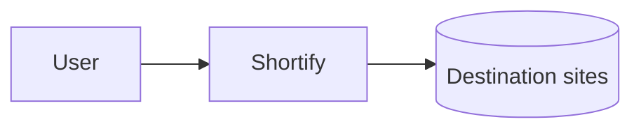
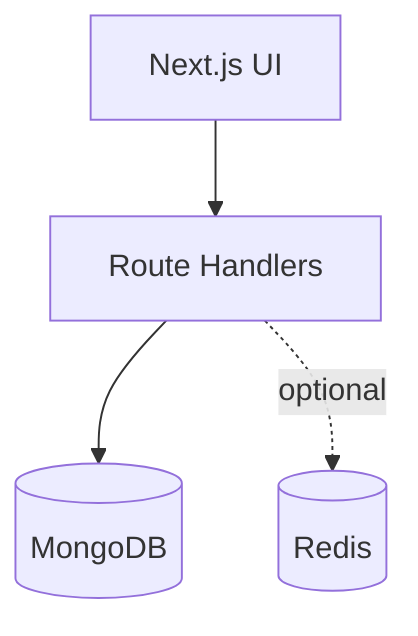
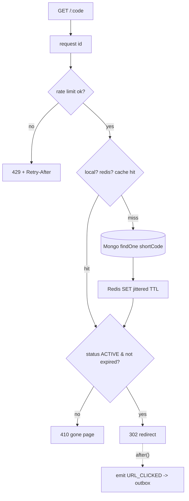
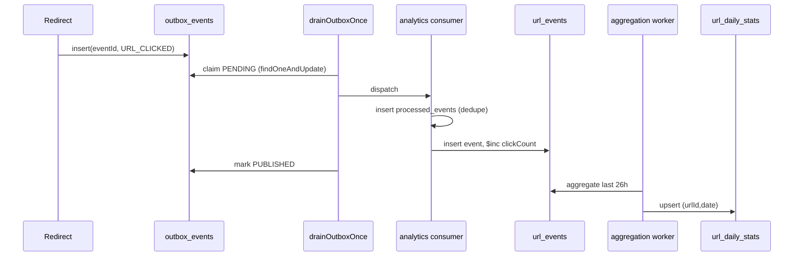
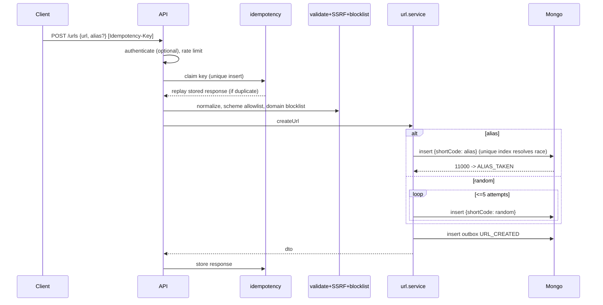
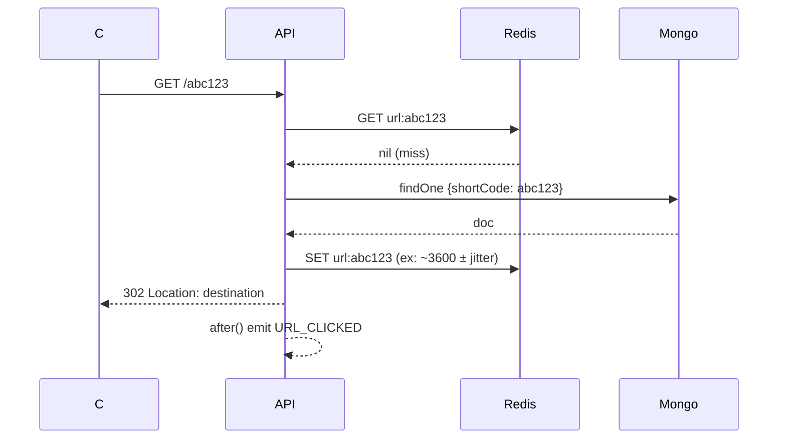
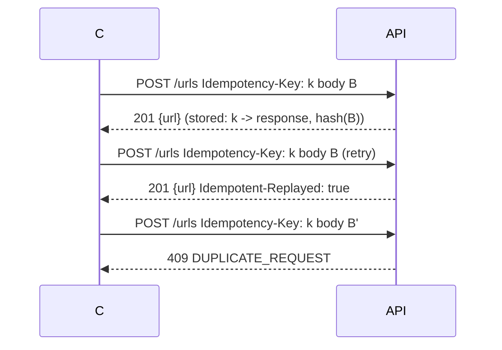

# Diagrams (Plan §70, §71)

## Level 1 — Product



## Level 2 — Application



## Level 3 — Production

```mermaid
flowchart TD
  CDN[Vercel Edge] --> MW[Middleware: req-id / CORS / CSP]
  MW --> WEB[UI]
  MW --> FN[API functions]
  FN --> R[(Upstash Redis)]
  FN --> M[(MongoDB Atlas)]
  FN --> OB[(outbox_events)]
  CRON[Daily Cron + after() drain] --> OB
  CRON --> WK[workers]
  WK --> M
```

## Level 4 — Redirect hot path



## Level 5 — Analytics path



## Sequence — Create URL



## Sequence — Redirect, cache miss



## Duplicate request


